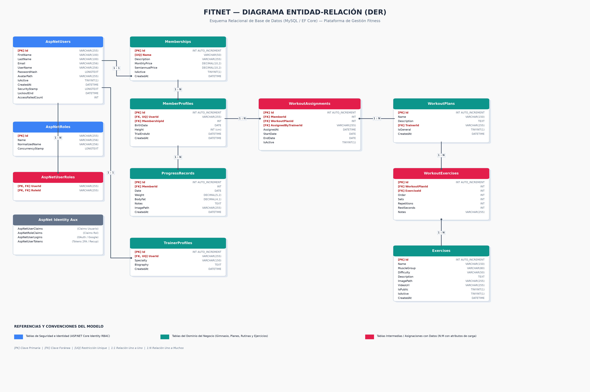
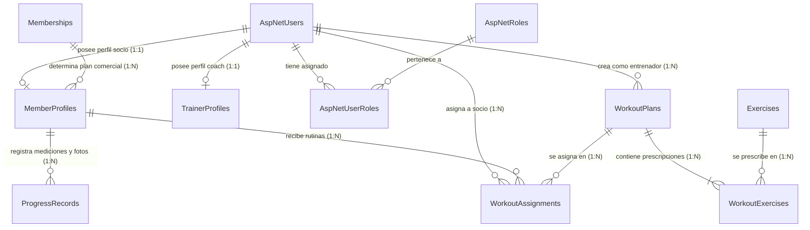

# FitNet — Plataforma Integral de Gestión Fitness y Entrenamiento

FitNet es una plataforma web desarrollada en **ASP.NET Core MVC (.NET 10)** para la administración integral de gimnasios y centros de entrenamiento físico. El sistema articula cuatro sectores operativos: portal público y comercial, portal de autogestión para socios (con biblioteca de ejercicios, rutinas y seguimiento de progreso con fotos), área de trabajo para entrenadores personales y dashboard administrativo con métricas analíticas del negocio.

---

# 1. Narrativa del Proyecto y Descripción del Problema

## Integrantes del grupo

- **Juan Esteban Carreras** - carrerasjuanesteban@gmail.com - [GitHub](https://github.com/CarrerasJuan)
- **Federico Galán** - federico.galan2023@gmail.com - [GitHub](https://github.com/Federico-Galan)

## Título y Temática elegida

* **Título del Proyecto:** FitNet — Plataforma Integral de Gestión Fitness y Entrenamiento.
* **Temática:** Sistema web de gestión para gimnasios, centros de acondicionamiento físico, entrenamiento personalizado y rendimiento deportivo.

## Descripción de la Problemática

En la actualidad, la gestión integral de gimnasios y centros de entrenamiento físico suele verse gravemente afectada por la dispersión de herramientas analógicas, planillas estáticas y canales informales. Esta falta de integración perjudica a cada uno de los actores fundamentales del establecimiento:

1. **Impacto en el Propietario (Owner):**
   * **Falta de control financiero e incertidumbre operativa:** El dueño del gimnasio necesita tener centralizados todos los cobros, renovaciones y suscripciones de los usuarios en una única plataforma. Sin esta información en tiempo real, resulta sumamente complejo proyectar el flujo de fondos necesario para cumplir en tiempo y forma con el pago de sueldos al personal (profesores y administrativos) y la adquisición o reposición de insumos (mantenimiento de máquinas, equipamiento, limpieza y servicios).
   * **Ausencia de trazabilidad en los ingresos y demanda estacional:** Se carece de métricas claras para contrastar ingresos mensuales frente a contrataciones semestrales, impidiendo anticipar y amortiguar los períodos de baja demanda de clientes típicos del rubro fitness.

2. **Impacto en el Personal Administrativo (Empleados de administración):**
   * **Desorganización en los cobros y control de cuotas:** Los administrativos no disponen de una herramienta ágil para verificar el estado de cuenta de cada socio, lo que genera cobros deficientes, demoras en el mostrador y falta de registro en el vencimiento de cuotas.
   * **Dificultad en la renovación de planes y altas de usuarios:** La gestión manual de socios dificulta detectar oportunamente planes vencidos para ofrecer su renovación, provocando fugas de cobro y pérdida de clientes por falta de seguimiento comercial.

3. **Impacto en los Profesores y Entrenadores (Coaches):**
   * **Seguimiento informal y desarticulado:** Al no contar con una plataforma unificada, los entrenadores deben recurrir a anotaciones en papel o chats de mensajería (WhatsApp), donde se pierden los registros históricos de cargas, series, repeticiones y tiempos de descanso.
   * **Pérdida del vínculo pedagógico-deportivo:** Resulta engorroso mantener un seguimiento continuo, individualizado y profesional de los atletas, limitando la capacidad del coach para evaluar evoluciones físicas y ajustar las prescripciones en el momento oportuno.

4. **Impacto en los Socios y Clientes (Usuarios):**
   * **Falta de segmentación y servicios acordes a sus necesidades:** Los usuarios no cuentan con un espacio digital privado adaptado al nivel de abono que contratan. Requieren una experiencia gradual y transparente:
     - En el período de prueba (**Trial de 24h**), evaluar la plataforma y conocer las instalaciones.
     - En planes intermedios (**Gold**), acceder a planificaciones diarias de entrenamiento provistas por el club y pautas de seguimiento alimenticio para acompañar el esfuerzo físico.
     - En planes avanzados (**Premium**), contar con un acompañamiento exclusivo **1 a 1 con su profesor/coach asignado**, herramientas de control nutricional como **cuenta-calorías y medidor de déficit calórico**, y acceso a **videos demostrativos de técnica de ejercicios** integrados a través de una API.
   * **Ausencia de registro biométrico y visual:** Carencia de un historial privado y seguro donde registrar peso corporal, porcentaje graso y contrastar fotográficamente su evolución física a lo largo de las semanas.

## Propuesta de Solución

FitNet aborda y resuelve integralmente esta problemática mediante una arquitectura web modular en **ASP.NET Core MVC**, articulando las necesidades de cada actor del gimnasio con seguridad de datos y componentes reactivos:

* **Para el Dueño (`Rol: Owner`):** Dashboard analítico centralizado con métricas de facturación proyectada (mensual y semestral), flujo estimado de caja para sueldos e insumos, desglose de socios activos por plan y tasas de retención frente a bajas de temporada.
* **Para el Personal Administrativo (`Rol: Admin`):** Módulo de gestión y cobranzas con directorio completo de socios, control de vigencia de cuotas, renovación inmediata de abonos y activación manual de membresías sin trabas para agilizar la atención.
* **Para los Entrenadores (`Rol: Trainer`):** Panel interactivo para el seguimiento de atletas asignados, creador de rutinas con prescripción exacta de ejercicios (series, repeticiones, descansos y observaciones técnicas) y visualización del historial de cada alumno en la misma plataforma.
* **Para los Socios (`Rol: Member`):** Portal de autogestión deportiva adaptado a su nivel de suscripción:
  * **Free:** Registro público con trial de 24 horas y biblioteca de ejercicios básicos.
  * **Gold:** Planificaciones diarias estructuradas por el gimnasio, catálogo completo de técnicas y pautas de seguimiento de alimentación.
  * **Premium:** Atención personalizada 1 a 1 con su coach particular, rutinas individuales a medida, seguimiento biométrico en *"Mi Progreso"* con fotos protegidas en servidor, estimador de déficit calórico / cuenta-calorías y visualización de videos técnicos consumidos mediante endpoints de API.
* **Portal Comercial y Landing Reactiva (Vue.js 3):** Portada comercial para captación de socios con calculadora de IMC en tiempo real, catálogo de disciplinas y simulador de planes.
* **Arquitectura Sólida y Segura:** Separación estricta entre los **roles de autorización Identity** (`Owner`, `Admin`, `Trainer`, `Member`) y el **modelo comercial de membresías** (`Free`, `Gold`, `Premium`), garantizando que las reglas de negocio y accesos se controlen íntegramente en el backend.

---

# 2. Modelo de Datos y Diagrama Entidad-Relación (DER)

## Diagrama Entidad-Relación (DER)

A continuación se presenta el esquema relacional de la base de datos `FitNetDb`. La imagen se encuentra disponible en alta resolución en la ruta [`./Diagrama/der.png`](./Diagrama/der.png):



### Esquema Interactivo (Mermaid)



## Listado y Descripción de Entidades

El modelo relacional está compuesto por **15 tablas**, divididas orgánicamente entre la capa de seguridad provista por ASP.NET Core Identity y la capa de dominio fitness del gimnasio:

### A. Capa de Seguridad e Identidad (ASP.NET Core Identity)

1. **`AspNetUsers` (Usuarios del Sistema):** Tabla principal de cuentas de usuario. Extiende `IdentityUser` con atributos propios del dominio: `FirstName` (nombre), `LastName` (apellido), `AvatarPath` (ruta física a la foto de perfil en `/uploads/avatars/`), `IsActive` (baja lógica de cuentas) y `CreatedAt` (fecha de alta).
2. **`AspNetRoles` (Roles de Seguridad):** Catálogo de roles de autorización del sistema (`Owner`, `Admin`, `Trainer`, `Member`).
3. **`AspNetUserRoles` (Asignación de Roles):** Tabla intermedia que vincula usuarios con sus respectivos roles de seguridad.
4. **`AspNetUserClaims`:** Almacenamiento de declaraciones (claims) particulares asignadas a usuarios específicos.
5. **`AspNetRoleClaims`:** Permisos detallados y directivas asociadas a roles de seguridad.
6. **`AspNetUserLogins`:** Proveedores de autenticación externa (preparado para integración con Google OAuth).
7. **`AspNetUserTokens`:** Tokens de verificación de correo, doble factor de autenticación (2FA) y recuperación de contraseña.

### B. Capa de Negocio y Dominio Fitness

8. **`Memberships` (Membresías Comerciales):** Modela los planes comerciales del club (`Free`, `Gold`, `Premium`), almacenando el nombre del plan, descripción, arancel mensual (`MonthlyPrice`), arancel semestral bonificado (`SemiannualPrice`) y estado de vigencia comercial.
9. **`MemberProfiles` (Perfil de Socio / Atleta):** Extiende a `AspNetUsers` para los usuarios con rol `Member`. Almacena la fecha de nacimiento (`BirthDate`), estatura en centímetros (`Height`), la membresía comercial asociada (`MembershipId`) y la marca temporal de expiración del período de prueba (`TrialEndsAt`), que define el corte del trial gratuito de 24 horas.
10. **`TrainerProfiles` (Perfil de Entrenador):** Extiende a `AspNetUsers` para los usuarios con rol `Trainer`. Registra la trayectoria profesional (`Biography`) y la especialidad deportiva del preparador físico (`Specialty`, ej. Hipertrofia, Funcional, Cross Training).
11. **`Exercises` (Biblioteca de Ejercicios):** Catálogo maestro de ejercicios. Registra nombre, descripción técnica de ejecución, grupo muscular (`MuscleGroup`), nivel de dificultad (`Difficulty`), imagen ilustrativa (`ImagePath`), video demostrativo (`VideoUrl`), estado activo y la bandera `IsPublic`, que determina si el ejercicio está disponible durante el trial Free o es exclusivo para socios Gold/Premium.
12. **`WorkoutPlans` (Planes de Rutina):** Representa las rutinas de entrenamiento. Almacena el nombre de la rutina, descripción general, el entrenador que la diseñó (`TrainerId`) y la bandera booleana `IsGeneral` (diferenciando las rutinas generales del gimnasio de los planes personalizados individuales para socios Premium).
13. **`WorkoutExercises` (Prescripción de Ejercicios en Rutina):** Tabla intermedia con atributos de carga que vincula una rutina (`WorkoutPlan`) con un ejercicio (`Exercise`). Modela la prescripción técnica precisa: orden de ejecución (`Order`), número de series (`Sets`), repeticiones por serie (`Repetitions`), tiempo de descanso en segundos (`RestSeconds`) e instrucciones u observaciones técnicas (`Notes`).
14. **`WorkoutAssignments` (Asignación de Rutinas a Socios):** Registra la asignación formal de un plan de entrenamiento a un socio específico, indicando la fecha de inicio (`StartDate`), fecha de fin proyectada (`EndDate`), la fecha de asignación (`AssignedAt`), el entrenador que realizó la prescripción (`AssignedByTrainerId`) y el estado de la asignación (`IsActive`).
15. **`ProgressRecords` (Registro de Progreso Biométrico y Fotos):** Almacena las mediciones periódicas del socio. Registra la fecha de control (`Date`), peso corporal en kilogramos (`Weight`), porcentaje estimado de grasa (`BodyFat`), notas del atleta y la ruta física a la fotografía de evolución física (`ImagePath` en `/uploads/progress/`), garantizando el cumplimiento del requisito de uso de archivos multimedia adicional al avatar.

## Descripción de Relaciones No Triviales

1. **Relación 1:1 entre Cuenta de Usuario y Perfiles Especializados (`AspNetUsers` $\leftrightarrow$ `MemberProfiles` / `TrainerProfiles`):**  
   En lugar de sobrecargar la tabla de autenticación con campos que solo aplican a ciertos roles, se utiliza una relación uno a uno estricta con clave foránea única (`UserId`). Esto desacopla la seguridad provista por Identity de los datos atléticos del socio (fecha de nacimiento, trial, altura) y de los datos laborales del entrenador (especialidad, biografía), manteniendo integridad referencial con eliminación en cascada.

2. **Desacoplamiento entre Roles de Seguridad y Membresías Comerciales (`Memberships` $\rightarrow$ `MemberProfiles` 1:N):**  
   Una de las decisiones arquitectónicas clave es que `Free`, `Gold` y `Premium` **no son roles de Identity**, sino instancias de la entidad comercial `Memberships`. Un usuario tiene el rol `Member` para acceder al portal del socio, pero su habilitación funcional (biblioteca completa vs. ejercicios públicos) es determinada por `MembershipService` en el backend validando su `MembershipId` y si su `TrialEndsAt` sigue vigente.

3. **Relación N:M Enriquecida con Atributos de Carga (`WorkoutPlans` $\leftrightarrow$ `Exercises` vía `WorkoutExercises`):**  
   Un plan de entrenamiento contiene múltiples ejercicios, y un mismo ejercicio puede formar parte de múltiples rutinas. La tabla intermedia `WorkoutExercises` no se limita a vincular claves foráneas: modela la prescripción atlética completa, almacenando el orden en la sesión, series, repeticiones, descansos y recomendaciones posturales.

4. **Historial de Asignaciones Temporales (`MemberProfiles` $\leftrightarrow$ `WorkoutPlans` vía `WorkoutAssignments`):**  
   La relación entre socios y rutinas no es estática. A través de `WorkoutAssignments`, un socio puede tener una rutina activa y un historial cronológico de rutinas previas, registrando además qué entrenador fue el responsable de la asignación (`AssignedByTrainerId`).

5. **Trazabilidad Biométrica y Archivos Físicos (`MemberProfiles` $\rightarrow$ `ProgressRecords` 1:N):**  
   Permite al socio cargar una secuencia cronológica de controles de evolución física. La relación asocia mediciones numéricas cuantitativas (peso, grasa) con archivos multimedia físicos (`ImagePath`), gestionados a través de `FileStorageService` con nombres únicos GUID y borrado físico al eliminar el registro.

---

# 3. Base de Datos y Puesta en Marcha Local

## Script de Base de Datos

El script oficial y saneado de creación e inicialización de la base de datos se encuentra ubicado en la raíz del proyecto:

```text
esquema.sql
```

El script genera la base `FitNetDb` con cotejamiento `utf8mb4_unicode_ci` y las directivas `SET NAMES utf8mb4;` para garantizar compatibilidad total con acentos y caracteres especiales en español.

### Configuración de Conexión (XAMPP / MySQL)

La aplicación está preconfigurada en `appsettings.json` para conectarse al servicio MySQL local de XAMPP con sus credenciales estándar:

```json
"ConnectionStrings": {
  "DefaultConnection": "Server=localhost;Port=3306;Database=FitNetDb;User=root;Password=;CharSet=utf8mb4;"
}
```

También se incluye un archivo `.env` en la raíz con los mismos parámetros para facilitar la replicación rápida del entorno local al equipo docente o integrantes del equipo:

```text
MYSQL_HOST=localhost
MYSQL_PORT=3306
MYSQL_DATABASE=FitNetDb
MYSQL_USER=root
MYSQL_PASSWORD=
MYSQL_CONNECTION_STRING=Server=localhost;Port=3306;Database=FitNetDb;User=root;Password=;CharSet=utf8mb4;
ASPNETCORE_ENVIRONMENT=Development
```

### Pasos para Importar la Base de Datos

#### Opción A — Desde la interfaz web de phpMyAdmin:
1. Abrir el panel de control de XAMPP e iniciar el servicio **MySQL**.
2. Ingresar desde el navegador a `http://localhost/phpmyadmin/`.
3. Seleccionar la pestaña superior **Importar**.
4. En *"Seleccionar archivo"*, elegir el archivo `esquema.sql` ubicado en la raíz de `FitNet`.
5. Presionar el botón **Importar / Continuar** al pie de la página.

#### Opción B — Desde la consola / terminal de comandos:
```powershell
cmd /c ""C:\xampp\mysql\bin\mysql.exe" -u root < esquema.sql"
```

## Usuarios de Prueba Precargados (Seed Oficial)

El sistema cuenta con un servicio de inicialización (`SeedService`) y datos en el script SQL para probar los distintos niveles de acceso:

| Rol | Correo Electrónico | Contraseña | Perfil y Nivel de Acceso |
|---|---|---|---|
| **Owner** | `owner@fitnet.com` | `Owner123!` | Propietario. Acceso a métricas de facturación y resumen global del negocio. |
| **Admin** | `admin@fitnet.com` | `Admin123!` | Administrador. Gestión de socios, activación manual de membresías y catálogo de ejercicios. |
| **Trainer** | `trainer@fitnet.com` | `Trainer123!` | Entrenador. Perfil profesional configurado y atletas asignados. |
| **Member** | `member@fitnet.com` | `Member123!` | Socio con membresía **Gold** activa (acceso completo a rutinas y ejercicios). |
| **Member (Trial)** | `trial@fitnet.com` | `Trial123!` | Socio con membresía **Free** y trial de 24 horas vigente. |

## Pasos para Levantar la Aplicación

### Prerrequisitos
* **.NET 10 SDK** instalado en el sistema.
* **XAMPP** con el servicio MySQL iniciado en el puerto 3306.

### Ejecución
1. Abrir una terminal en la carpeta del proyecto `FitNet`:
   ```powershell
   cd FitNet
   ```
2. Restaurar dependencias y compilar:
   ```powershell
   dotnet build
   ```
3. Ejecutar la plataforma web:
   ```powershell
   dotnet run
   ```
4. Ingresar desde el navegador web a la URL indicada en la consola (ej. `https://localhost:5001` o `http://localhost:5000`).

---

# 4. Arquitectura y Stack Tecnológico

* **Lenguaje y Framework:** C# sobre **ASP.NET Core MVC (.NET 10)**.
* **Persistencia y ORM:** Entity Framework Core (`MySql.EntityFrameworkCore 10.0.9`) con mapeo mediante Fluent API y soporte para migraciones.
* **Base de Datos:** MySQL / MariaDB (XAMPP).
* **Seguridad y Autenticación:**
  * **ASP.NET Core Identity:** gestión de usuarios, contraseñas con hashing seguro (PBKDF2) y control de acceso basado en roles (`RBAC`).
  * **Esquema Dual:** Autenticación por Cookies seguras para la interfaz MVC y tokens **JWT Bearer** para la capa de servicios API REST.
* **Frontend y Vistas:**
  * Renderizado del lado del servidor mediante **Razor Views** (`.cshtml`).
  * **Vue.js 3** (Composition API sin bundlers ni dependencias de Node.js en runtime) y **Axios** para operaciones asíncronas y dinamismo reactivo vía AJAX.
  * **Bootstrap 5** para diseño adaptativo, grillas responsive y consistencia estética.
  * **Font Awesome 6 Free** con activos alojados 100% de forma local en `wwwroot/lib/`.
* **Servicio Seguro de Almacenamiento (`FileStorageService`):**
  * Nombres de archivo únicos generados mediante GUID.
  * Validación server-side estricta de extensiones (`.jpg`, `.jpeg`, `.png`, `.webp`) y tipos MIME.
  * Borrado físico en disco al eliminar o sustituir avatares o fotografías de evolución.

## Estructura del Repositorio

```text
FitNet/
├── Controllers/         # Controladores MVC (Home, Account, Exercises, Members, Admin, Billing)
├── Api/Controllers/     # Controladores API REST desacoplados (Auth, Exercises, Members)
├── Models/              # Entidades del dominio relacional (ApplicationUser, MemberProfile, etc.)
├── ViewModels/          # Modelos de vista para formularios e interfaces Razor
├── Services/            # Lógica de negocio (MembershipService, FileStorageService, SeedService)
├── Data/                # ApplicationDbContext, configuraciones Fluent API y migraciones
├── Views/               # Vistas Razor estructuradas por controlador y layout compartido
├── Diagrama/            # Diagrama Entidad-Relación en alta resolución (der.png)
├── esquema.sql          # Script SQL de creación e inicialización de FitNetDb
├── .env                 # Variables de entorno y configuración local XAMPP
├── appsettings.json     # Configuración de conexiones y parámetros de la plataforma
└── wwwroot/             # Recursos estáticos locales
    ├── css/             # Hojas de estilo propias
    ├── js/vue-apps/     # Aplicaciones Vue 3 modulares e independientes
    ├── lib/             # Librerías locales (Vue 3, Axios, Bootstrap 5, Font Awesome)
    └── uploads/         # Almacenamiento físico de imágenes (avatars, progress, exercises)
```
